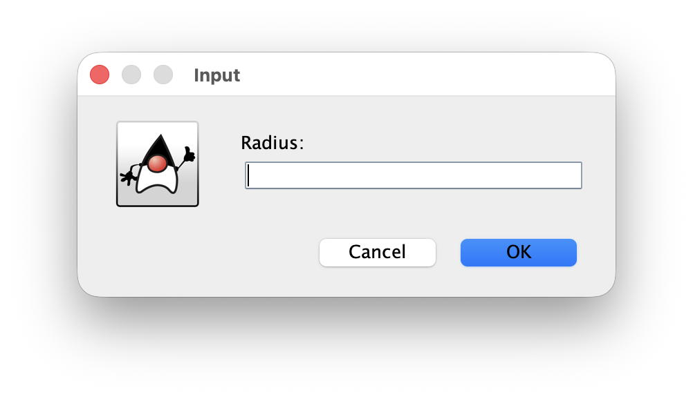
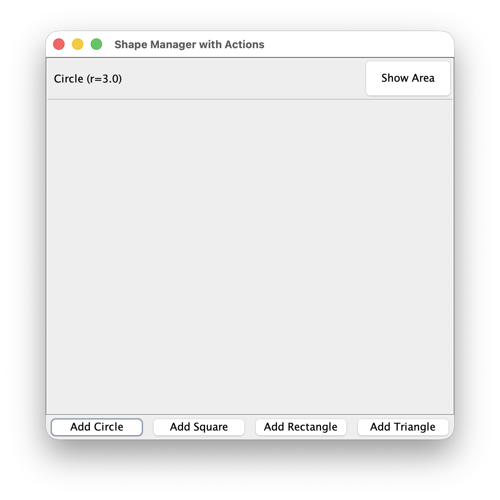
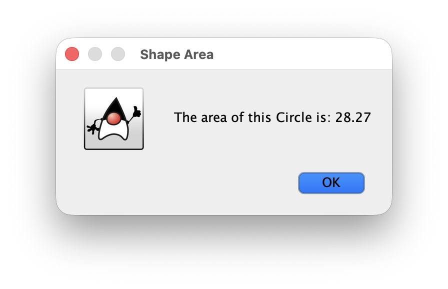
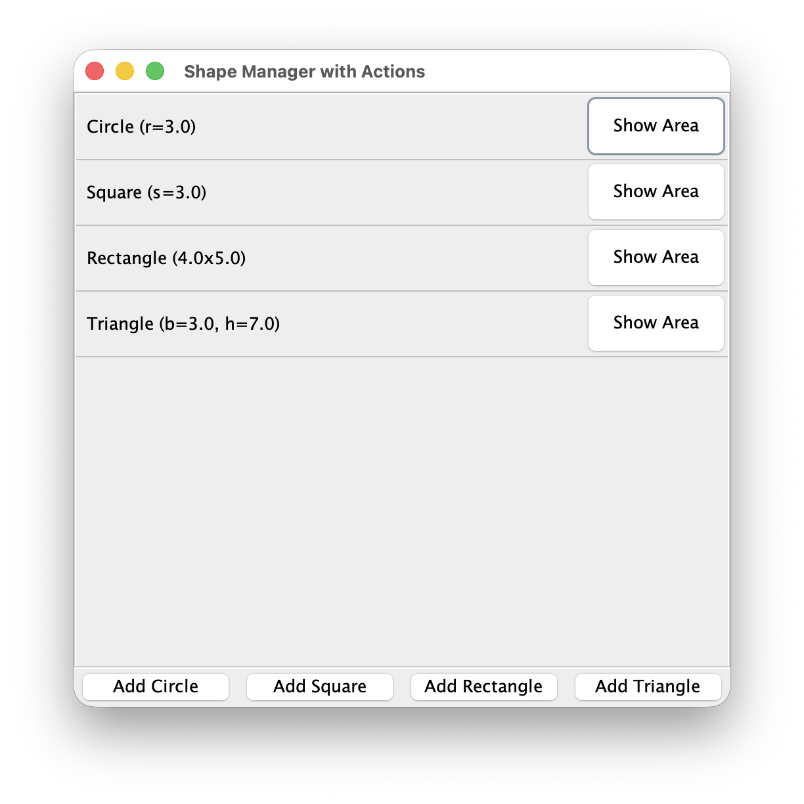

# OOP_Assign_02: Shape Manager
## Collaborators:
    - Tafseer Khan
## Installation
```bash
javac edu/txst/assignment2/*.java
java edu.txst.assignment2.ShapeManager
```

## Screenshots
### Empty Shape Manager


### Entering a Circle's Radius


### Circle Created


### Viewing the Circle's Area


### All Shapes Created

